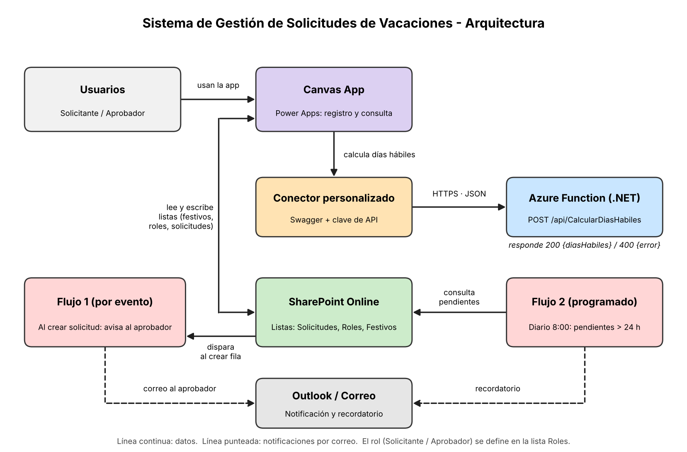
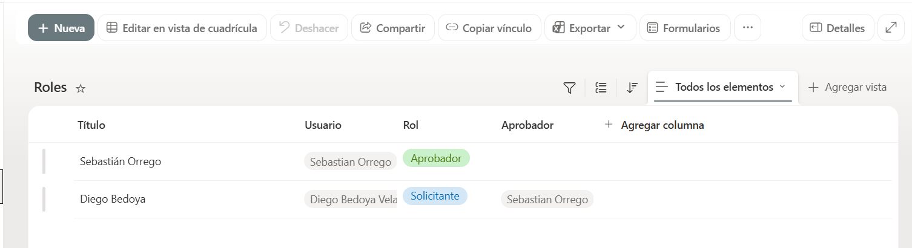
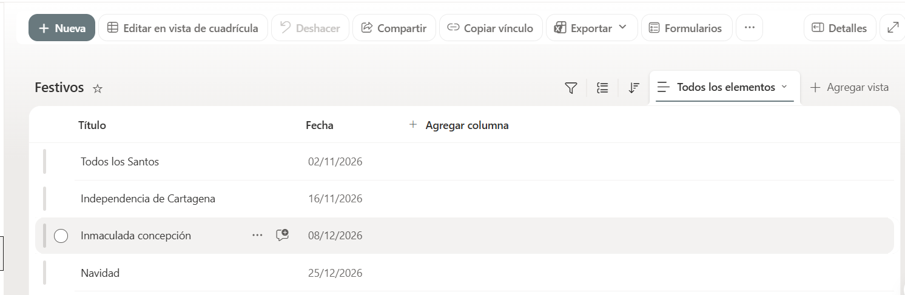
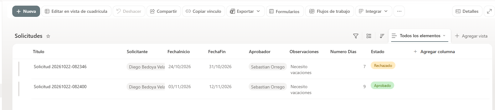
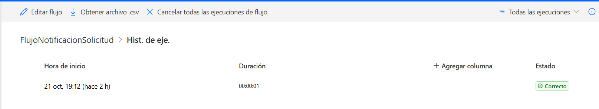
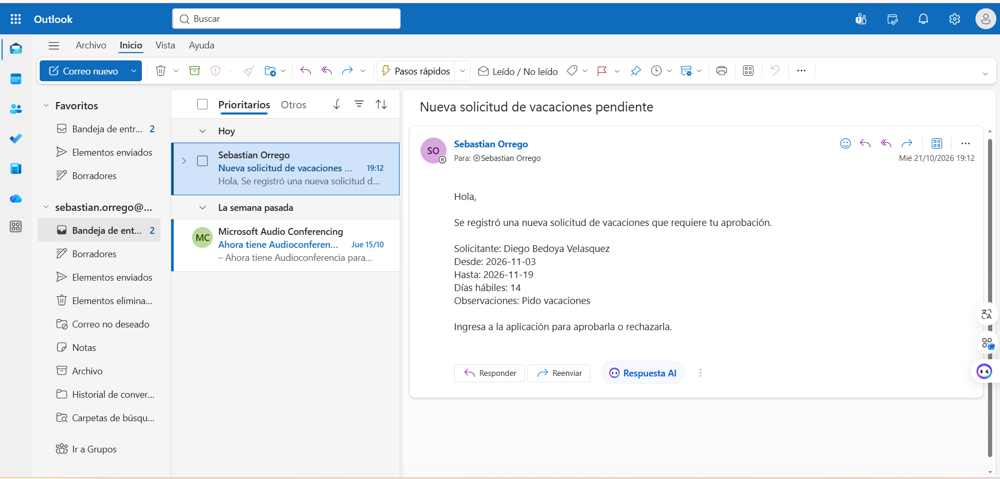
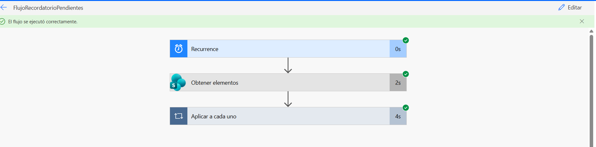
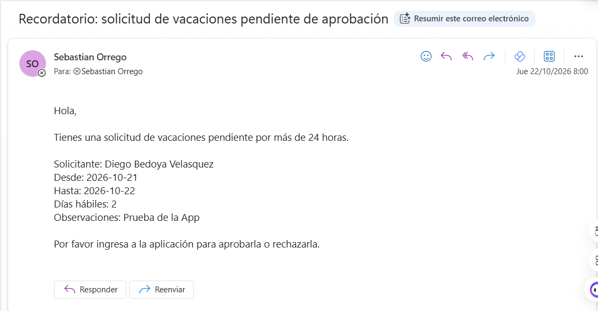
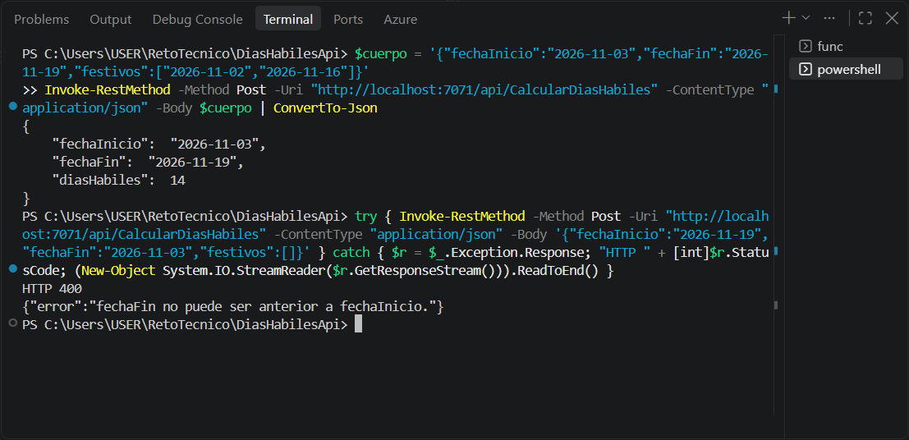

# Sistema de Gestión de Solicitudes de Vacaciones

Este es mi desarrollo para el reto técnico de Power Platform + Pro-Code. El sistema permite registrar y consultar solicitudes de vacaciones desde una Canvas App, con comportamiento distinto según el rol (Solicitante o Aprobador). Los datos viven en listas de SharePoint, dos flujos de Power Automate envían las notificaciones, y una API en Azure Functions (.NET 10, C#) calcula los días hábiles.

## Arquitectura

<p align="center">
  
</p>

- **Canvas App**: pantalla de registro y de consulta, con navegación entre ellas.
- **SharePoint Online**: listas `Solicitudes`, `Roles` y `Festivos`.
- **API en Azure Functions**: calcula los días hábiles entre dos fechas.
- **Conector personalizado** `DiasHabilesApi`: conecta la app con la API (Swagger y autenticación por clave).
- **Power Automate**: un flujo por evento y un flujo programado.

## Estructura del repositorio

| Carpeta o archivo | Contenido |
| --- | --- |
| `CalcularDiasHabiles.cs` | La función HTTP: lee la petición, valida los datos y responde. |
| `CalculadoraDiasHabiles.cs` | La lógica del cálculo. La separé de la función para que no dependa de HTTP y sea fácil de explicar y probar. |
| `Models.cs` | Los modelos de entrada y salida, que definen el JSON. |
| `Program.cs` | El arranque del host de Azure Functions. |
| `solucion/` | Solución de Power Platform exportada (`SolicitudesVacaciones_1_0_0_1.zip`). |
| `evidencias/` | Capturas de las listas, los flujos, la API y el diagrama de arquitectura. |

## Solución de Power Platform

La solución `SolicitudesVacaciones` (no administrada) está en `solucion/SolicitudesVacaciones_1_0_0_1.zip` e incluye la app, los dos flujos y el conector.

### Canvas App `AppSolicitudesVacaciones`

- **Pantalla de inicio**: muestra el rol del usuario y los botones de navegación.
- **Registrar solicitud**: el usuario elige las fechas, la app valida que la fecha de fin sea posterior a la de inicio, calcula los días hábiles llamando a la API y guarda la solicitud en SharePoint con estado `Pendiente`.
- **Consulta**: el Solicitante ve sus solicitudes; el Aprobador ve las que le corresponden y puede **aprobarlas o rechazarlas**.
- **Roles**: el rol sale de la lista `Roles` según el correo del usuario que abre la app. Los botones de registrar y de aprobar o rechazar se muestran solo al rol que corresponde.
- **Modo demo**: agregué un botón para alternar entre Aprobador y Solicitante, porque en el entorno de pruebas se trabaja con un solo usuario conectado.
- **Manejo de errores de la API**: la llamada va dentro de `IfError`. Si la API responde con error, la app muestra el mensaje y no se rompe.

### Flujos de Power Automate

| Flujo | Tipo | Qué hace |
| --- | --- | --- |
| `FlujoNotificacionSolicitud` | Por evento (SharePoint: *Cuando se crea un elemento*) | Envía un correo al aprobador cuando se registra una solicitud nueva. |
| `FlujoRecordatorioPendientes` | Programado (todos los días, 8:00 a. m., hora de Colombia) | Busca las solicitudes en `Pendiente` con más de 24 horas y envía un recordatorio al aprobador de cada una. |

El filtro del flujo programado es: `Estado eq 'Pendiente' and Created lt (ahora - 1 día)`. Lo ejecuta SharePoint, así que el flujo solo recibe las solicitudes que necesita.

### Listas de SharePoint

- **Solicitudes**: título, solicitante, aprobador, fecha de inicio, fecha de fin, observaciones, número de días y estado (`Pendiente`, `Aprobado`, `Rechazado`).
- **Roles**: usuario, rol y aprobador asignado.
- **Festivos**: título y fecha.

### Cómo importar la solución

En Power Apps o Power Automate: **Soluciones** → **Importar solución**, elegir el `.zip` y configurar las conexiones (SharePoint, Outlook y el conector `DiasHabilesApi`, con la clave de la función).

## API de días hábiles

Función HTTP en Azure Functions (.NET 10, modelo aislado, C#) que calcula cuántos días hábiles hay entre dos fechas. La consumo desde la Canvas App a través del conector personalizado.

### Cómo calcula los días hábiles

- Cuento la fecha de inicio y la de fin, ambas incluidas.
- Tomo de lunes a sábado como días hábiles. Me basé en el ejemplo del enunciado (del 2 al 7 de noviembre de 2026, con el lunes festivo, da 5 días).
- No cuento los domingos.
- No cuento las fechas que lleguen en la lista de festivos.

Decidí que los festivos lleguen en cada petición y no escribirlos en el código. En la Power App los leo de la lista `Festivos` de SharePoint y se los envío a la API. Así, si cambia un festivo, solo edito la lista y no tengo que volver a desplegar.

### Endpoint

`POST /api/CalcularDiasHabiles`

La función tiene nivel de autorización `Function`, así que hay que enviar su clave (parámetro `code` o encabezado `x-functions-key`). Lo hice así para que la API no quede abierta a cualquiera en internet.

### Petición

```json
{
  "fechaInicio": "2026-11-02",
  "fechaFin": "2026-11-07",
  "festivos": ["2026-11-02"]
}
```

Las fechas van en formato `yyyy-MM-dd`. El campo `festivos` es opcional.

### Respuesta (200)

```json
{
  "fechaInicio": "2026-11-02",
  "fechaFin": "2026-11-07",
  "diasHabiles": 5
}
```

### Errores (400)

Agregué validaciones para que la API responda un mensaje claro en vez de fallar. Devuelve error 400 cuando:

- El cuerpo no es un JSON válido o viene vacío.
- `fechaInicio` o `fechaFin` faltan o no tienen el formato `yyyy-MM-dd`.
- `fechaFin` es anterior a `fechaInicio`.
- Algún festivo no tiene el formato `yyyy-MM-dd`.

```json
{ "error": "fechaFin no puede ser anterior a fechaInicio." }
```

### Cómo ejecutarla en local

Necesito el SDK de .NET 10 y Azure Functions Core Tools 4.

```
dotnet build
func start
```

Para probarla:

```
$body = '{"fechaInicio":"2026-11-02","fechaFin":"2026-11-07","festivos":["2026-11-02"]}'
Invoke-RestMethod -Method Post -Uri http://localhost:7071/api/CalcularDiasHabiles -ContentType "application/json" -Body $body
```

En local no pide clave. Los avisos sobre `AzureWebJobsStorage` los ignoro, porque la función solo usa HTTP y no necesita almacenamiento.

### Despliegue

La desplegué en una Function App (Flex Consumption, Linux) dentro del grupo de recursos `GR_Sebastian_Orrego`, usando la extensión de Azure Functions de VS Code (`Azure Functions: Deploy to Function App`).

La clave de la función no está en este repositorio. En el conector personalizado de Power Platform la configuro como parámetro de autenticación.

## Evidencias

Todas las capturas están en la carpeta `evidencias/`.

### Listas de SharePoint

**Roles**

<p align="center">
  
</p>

**Festivos**

<p align="center">
  
</p>

**Solicitudes**

<p align="center">
  
</p>

### Flujo 1: notificación al crear una solicitud

**Ejecución correcta**

<p align="center">
  
</p>

**Correo recibido por el aprobador**

<p align="center">
  
</p>

### Flujo 2: recordatorio de solicitudes pendientes

**Ejecución correcta**

<p align="center">
  
</p>

**Recordatorio recibido** (enviado automáticamente el 22/10/2026 a las 8:00 a. m.)

<p align="center">
  
</p>

### API: respuestas 200 y 400

<p align="center">
  
</p>

## Problemas que encontré

- **Azure CLI bloqueada.** Al iniciar sesión con `az login` con el usuario del reto me salió el error 530035, una política del tenant que bloquea ese acceso. No lo pude cambiar yo, así que desplegué desde la extensión de VS Code, que no tiene ese bloqueo.
- **Error 502 después del primer despliegue.** La Function App estaba creada con .NET 10 y mi proyecto apuntaba a .NET 8, así que Azure no podía arrancar el código. Cambié el proyecto a `net10.0`, actualicé la ruta de publicación en `.vscode/settings.json` y volví a desplegar. El documento pide .NET 8 o superior, por lo que cumple.
- **Error 401 en la app después de renovar la clave.** Las conexiones del conector guardan la clave cuando se crean. Al renovarla en Azure, tuve que recrear la conexión en Power Apps.
- **Consulta no válida en el flujo programado.** Usé `Estado/Value` en el filtro de SharePoint, pero `Estado` es una columna de tipo Elección y se filtra directamente por `Estado`. Lo encontré en el historial de ejecuciones y lo corregí.
- **Fila sin aprobador.** El flujo falló con "To Field cannot be null" por una solicitud de prueba sin aprobador. Eliminé esa fila y dejé anotada la mejora.

## Decisiones, supuestos y mejoras posibles

- El sábado cuenta como día hábil, según el ejemplo del enunciado.
- Los festivos llegan en la petición para no dejarlos fijos en el código.
- Dejé la lógica del cálculo en una clase aparte para mantener el código claro y mantenible.
- El rol se define en la lista `Roles`, no en el código, así que agregar un aprobador es agregar una fila.
- **Mejora:** una condición dentro del flujo programado para omitir las solicitudes sin aprobador.
- **Mejora:** limitar el recordatorio para que no se repita todos los días sobre la misma solicitud (por ejemplo, con una columna de último recordatorio).
- **Mejora:** reemplazar la clave de la función por autenticación con Microsoft Entra ID, o guardarla en Azure Key Vault.